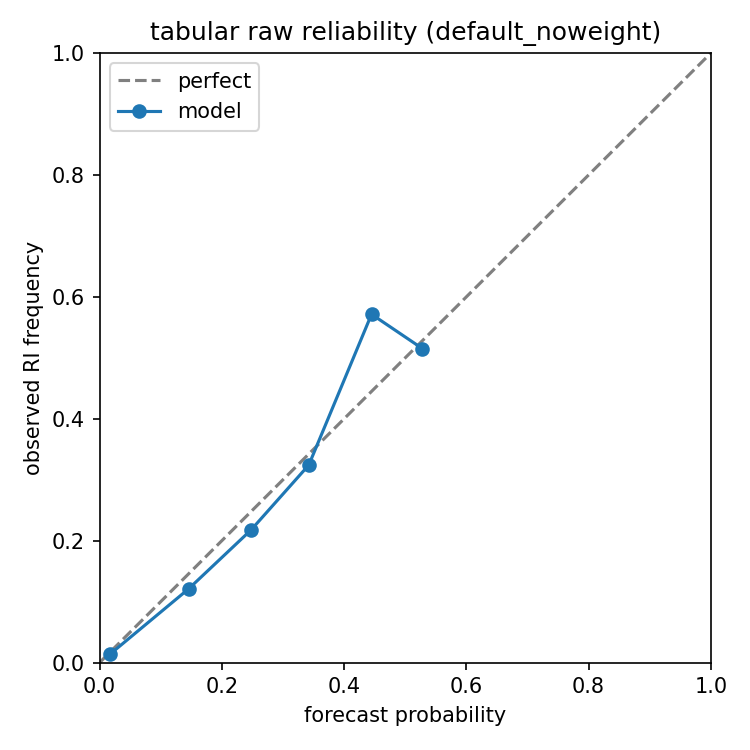
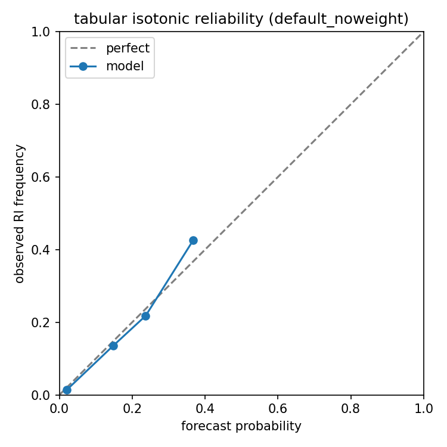
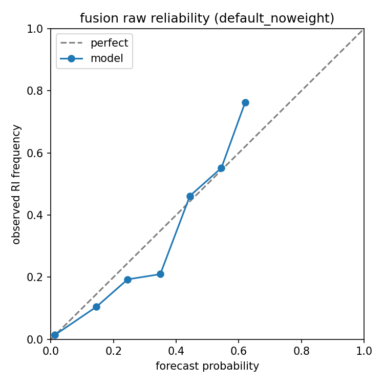
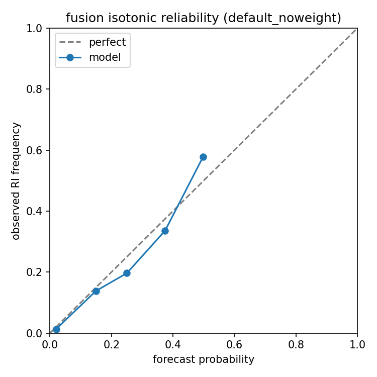

# hurricane-ri-forecast

Probabilistic **24-hour tropical cyclone rapid intensification (RI)** on public NOAA **TC PRIMED** (storm-centered IR + environmental fields).

**RI definition:** maximum sustained wind increases by **≥ 30 kt** in **24 hours**.

<p align="center">
  
</p>

## Overview

Ablation of tabular MLP, IR CNN, gated fusion, and gradient-boosting (GBM) controls for probabilistic RI on TC PRIMED (AL+EP; train/validation 2017–2022; test 2023–2024). The study focuses on how **evaluation choices**—class weighting, calibrator matching, storm-clustered uncertainty, and classical baseline protocol—change IR-versus-tabular conclusions. It is complementary to SHIPS/IR ablations such as Lagerquist et al. (2025), not an operational SHIPS-RII comparison.

## Features

- Pipeline: download → prepare → train → evaluate → compare
- Pathways: tabular MLP, IR CNN, gated fusion, GBM
- Season holdout, BSS / ROC-AUC, storm-clustered intervals, reliability
- Calibration: isotonic (primary for reported claims), temperature / Platt diagnostics
- Manuscript sources in `paper/arXiv/` and `paper/OLAR/`

## Dataset

Source: [TC PRIMED](https://rammb-data.cira.colostate.edu/tcprimed/) (NOAA / CIRA) · AWS `s3://noaa-nesdis-tcprimed-pds`

| Split | Seasons | Basins |
|-------|---------|--------|
| Train / validation | 2017–2022 | AL, EP |
| Test | 2023–2024 | AL, EP |

Prepared corpus: **33,878** samples (**1,409** RI). Test set: **8,113** samples (**75** storms, **393** RI events, rate **4.8%**).

## Main results (held-out 2023–2024)

Seed-averaged isotonic BSS with storm-clustered 95% intervals unless noted. Primary neural protocol is **unweighted** BCE; primary GBM is the **validation-selected** sklearn-default-like setting.

### Overall skill (BSS)

| Model / protocol | Calibrator | BSS [CI] |
|------------------|------------|----------|
| MLP weighted | raw | −0.43 [−1.09, −0.03] |
| MLP weighted | isotonic | +0.20 [0.10, 0.27] |
| Imagery weighted | raw | +0.00 [−0.09, 0.10] |
| Imagery weighted | isotonic | +0.05 [0.02, 0.09] |
| Fusion weighted | raw | −0.13 [−0.66, 0.16] |
| Fusion weighted | isotonic | +0.21 [0.11, 0.27] |
| MLP unweighted | isotonic | +0.20 [0.09, 0.27] |
| Imagery unweighted | isotonic | +0.03 [−0.02, 0.07] |
| Fusion unweighted | isotonic | +0.22 [0.12, 0.30] |
| IR-scalars-only MLP | isotonic | +0.08 [0.03, 0.11] |
| GBM default (3-seed, primary) | isotonic | +0.11 [−0.05, 0.21] |
| GBM regularized (post hoc) | isotonic | +0.21 [0.11, 0.27] |

### Paired contrasts (ΔBSS)

| Contrast | ΔBSS | 95% CI |
|----------|------|--------|
| Fusion − MLP (isotonic) | +0.03 | [−0.01, 0.07] |
| IR-scalars MLP − imagery (isotonic) | +0.05 | [−0.01, 0.10] |
| Fusion − GBM default (isotonic) | +0.11 | [0.04, 0.23] |
| MLP − GBM default (isotonic) | +0.09 | [0.01, 0.20] |
| Imagery − MLP (isotonic) | −0.16 | [−0.24, −0.07] |

### Discrimination (seed-averaged ROC-AUC)

| Model | AUC |
|-------|-----|
| MLP unweighted | 0.905 |
| Fusion unweighted | 0.904 |
| GBM default | 0.889 |
| GBM regularized (post hoc) | 0.906 |
| IR-scalars-only MLP | 0.841 |
| Imagery unweighted | 0.778 |
| Imagery weighted | 0.74 |

### Takeaways

- Neural-versus-GBM ranking depends on the classical-control protocol (validation-locked default ≈ +0.11 BSS; a post-hoc regularized GBM reaches +0.21 on test but is not validation-locked).
- Class weighting produces a large raw MLP deficit; isotonic and unweighted training recover BSS, but weighting still changes imagery AUC.
- Under shared trainer defaults, fusion does not significantly exceed the MLP; imagery does not significantly exceed six IR scalars.

### Reliability (unweighted primary runs)

<p align="center">
  
  
</p>

<p align="center">
  
  
</p>

<p align="center"><em>Unweighted MLP and fusion reliability (seed 42): raw vs isotonic.</em></p>

### Weighted-run reliability (ablation reference)

<p align="center">
  
  
  
</p>

<p align="center"><em>Left to right: tabular, imagery, fusion under the original class-weighted protocol.</em></p>

### Case study (fusion)

<p align="center">
  
</p>

<p align="center"><em>Fusion hit / miss / false alarm on held-out IRWIN scenes.</em></p>

## Repository layout

```text
hurricane-ri-forecast/
├── configs/
├── paper/
│   ├── arXiv/
│   └── OLAR/
├── data/
├── notebooks/
├── outputs/
├── scripts/
├── src/
├── assets/
└── requirements.txt
```

## Setup

```bash
git clone <your-repo-url> hurricane-ri-forecast
cd hurricane-ri-forecast
python -m venv .venv
# Windows: .venv\Scripts\activate
# Linux/macOS: source .venv/bin/activate
pip install -r requirements.txt
```

A GPU is recommended for imagery and fusion training.

## Usage

```bash
python scripts/download_data.py --config configs/default.yaml --season 2018 --basin AL
python scripts/prepare_data.py --config configs/default.yaml
python scripts/train.py --config configs/default.yaml --seed 42
python scripts/evaluate.py --config configs/default.yaml --model fusion
python scripts/compare_models.py --config configs/default.yaml
```

Multi-seed and regime utilities live under `scripts/`. Single-storm config: `configs/al062018.yaml`.

## Citation

Cite TC PRIMED and follow NOAA open-data attribution when using this project or the data. Manuscript citation will be added upon preprint / journal publication.
