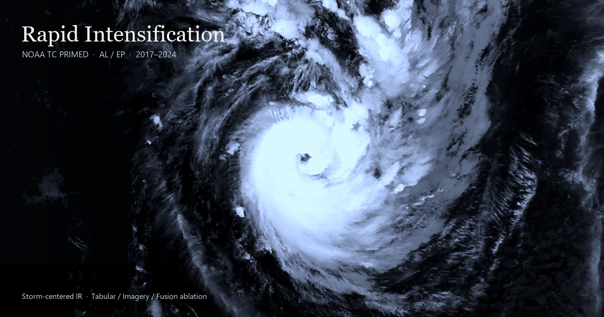
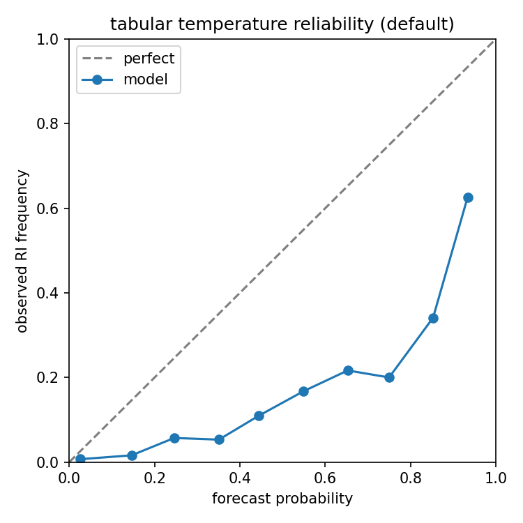
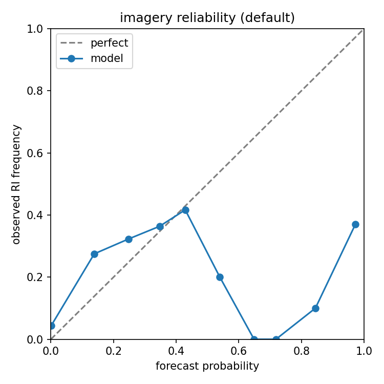
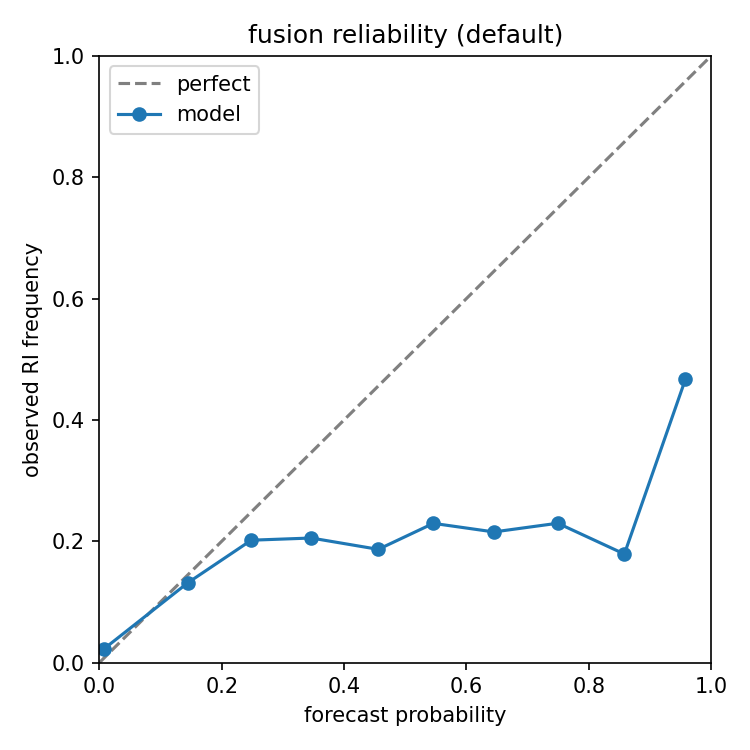
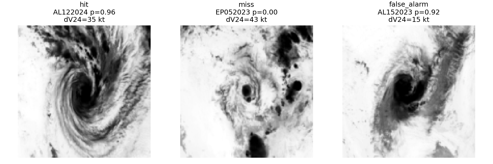

# hurricane-ri-forecast

Research project on **probabilistic 24-hour hurricane rapid intensification (RI)** using NOAA storm-centered satellite infrared imagery and environmental fields from **TC PRIMED**.

**RI definition used here:** maximum sustained wind increases by **≥ 30 kt** in **24 hours**.

<p align="center">
  
</p>

## Research question

> Does raw storm-centered satellite imagery add RI forecast skill beyond environmental and infrared-summary predictors (SHIPS-like tabular inputs)?

This is a research ablation study. The goal is **not** to beat operational NOAA products from public data alone. The goal is a fair, reproducible answer about whether imagery helps, and when it fails.

## What this repo contains

- End-to-end pipeline: download → prepare → train → evaluate → compare
- NOAA **TC PRIMED** ingestion (NetCDF overpasses + environmental diagnostics)
- Three-model ablation:
  - `tabular`: environment + IR summary features
  - `imagery`: CNN on storm-centered `IRWIN`
  - `fusion`: gated tabular + imagery model
- Season-held-out evaluation (train/val on 2017–2022, test on 2023–2024)
- Probabilistic metrics: Brier score, Brier skill vs climatology, bootstrap intervals, reliability
- Case analysis: hit, miss, and false alarm
- Resume-friendly prepare (storm checkpoints + optional `--shard 0/2` parallel workers)

## Dataset

Source: [TC PRIMED](https://rammb-data.cira.colostate.edu/tcprimed/) (NOAA / CIRA), public AWS bucket:

`s3://noaa-nesdis-tcprimed-pds`

Default scope (`configs/default.yaml`):

| Split | Seasons | Basins |
|---|---|---|
| Train / val | 2017–2022 | AL, EP |
| Test | 2023–2024 | AL, EP |

Prepared experiment size (current run):

- **33,878** samples
- **1,409** RI events (~4.2%)
- splits: train 18,986 / val 6,779 / test 8,113

Raw layout:

```text
data/raw/tcprimed/<year>/<basin>/<storm_id>/
```

## Main results (held-out 2023–2024)

| Model | Brier ↓ | BSS vs climatology | POD | Success ratio |
|---|---:|---:|---:|---:|
| tabular | 0.074 | -0.603 | 0.702 | 0.270 |
| imagery | **0.049** | -0.068 | 0.031 | 0.231 |
| fusion | 0.056 | -0.211 | 0.356 | 0.303 |

Reading this honestly:

- **Fusion beats tabular** on Brier skill (`fusion BSS - tabular BSS ≈ +0.39`).
- **No model beats climatology** yet (all BSS < 0).
- Tabular over-predicts RI (high POD, many false alarms).
- Imagery under-predicts RI (almost never fires).
- Accuracy is **not** the headline metric: RI is rare (~5%), so a trivial “never RI” predictor looks accurate and is still useless.

### Reliability (held-out test)

<p align="center">
  
  
  
</p>

<p align="center"><em>Left to right: tabular, imagery, fusion. All three are overconfident relative to the diagonal; imagery stays closest to climatology by rarely predicting RI.</em></p>

### Case study (fusion)

<p align="center">
  
</p>

<p align="center"><em>Fusion hit / miss / false alarm on held-out IRWIN scenes.</em></p>

## Research gap / paper direction

Many RI deep-learning reports emphasize that imagery or CNNs “improve” prediction. Fewer ask:

1. Does imagery add skill **beyond SHIPS-like predictors**?
2. Does that improvement survive a **climatology** reference and calibration audit?
3. What failure modes appear (over-firing vs under-firing)?

This project targets that gap. A defensible paper angle:

> When storm-centered satellite imagery helps (and fails) for probabilistic rapid-intensification prediction: a TC PRIMED ablation study.

## Repository structure

```text
hurricane-ri-forecast/
├── configs/
├── data/
│   ├── raw/tcprimed/        # large, not committed
│   ├── interim/             # prepare checkpoints, not committed
│   └── processed/           # tensors/tables, not committed
├── notebooks/
├── outputs/
│   ├── checkpoints/         # weights, not committed
│   ├── metrics/             # eval/ablation json (can commit)
│   └── figures/             # case/reliability plots (can commit)
├── scripts/
│   ├── download_data.py
│   ├── prepare_data.py
│   ├── train.py
│   ├── evaluate.py
│   └── compare_models.py
└── src/
    ├── data/
    ├── models/
    ├── train/
    └── eval/
```

## Setup

```bash
git clone <your-repo-url> hurricane-ri-forecast
cd hurricane-ri-forecast
python -m venv .venv
# Windows: .venv\Scripts\activate
# Linux/macOS: source .venv/bin/activate
pip install -r requirements.txt
```

GPU is recommended for the full experiment.

## Pipeline

### 1. Download

```bash
python scripts/download_data.py --config configs/default.yaml --season 2018 --basin AL
```

Interrupted downloads can be resumed; existing files are skipped.

### 2. Prepare

```bash
python scripts/prepare_data.py --config configs/default.yaml
```

Parallel prepare on two machines/Colab sessions:

```bash
python scripts/prepare_data.py --config configs/default.yaml --shard 0/2
python scripts/prepare_data.py --config configs/default.yaml --shard 1/2
python scripts/prepare_data.py --config configs/default.yaml --assemble-only
```

### 3. Train

```bash
python scripts/train.py --config configs/default.yaml
```

### 4. Evaluate and compare

```bash
python scripts/evaluate.py --config configs/default.yaml --model tabular
python scripts/evaluate.py --config configs/default.yaml --model imagery
python scripts/evaluate.py --config configs/default.yaml --model fusion
python scripts/compare_models.py --config configs/default.yaml
```

## Single-storm sanity check

```bash
python scripts/prepare_data.py --config configs/al062018.yaml
python scripts/train.py --config configs/al062018.yaml
python scripts/evaluate.py --config configs/al062018.yaml --model fusion
```

## Google Colab notes

```python
from google.colab import drive
import os

drive.mount('/content/drive', force_remount=True)
os.chdir('/content/drive/MyDrive/hurricane-ri-forecast')
os.environ['KMP_DUPLICATE_LIB_OK'] = 'TRUE'
!pip -q install -r requirements.txt
```

If Drive drops (`Transport endpoint is not connected`), remount and rerun the interrupted command. Prepare resumes from storm checkpoints.

## Evaluation notes

- Split by **season**, never by random frames from the same storm.
- Report probabilistic skill, not accuracy.
- TC PRIMED environmental fields include reanalysis diagnostics: research setting, not claimed real-time operations.
- Optional SHIPS-RII CSV comparison is supported, but beating SHIPS-RII is not the project goal.

```bash
python scripts/evaluate.py --config configs/default.yaml --model fusion --ships-csv data/raw/ships_rii/probabilities.csv
```

CSV columns: `storm_id,time,ships_rii_prob`

## Configs

| File | Purpose |
|---|---|
| `configs/default.yaml` | Full AL/EP multi-season experiment |
| `configs/al062018.yaml` | Single-storm subset |

## Next steps

- Probability calibration
- Basin / intensity breakdowns
- Deeper failure-mode analysis for a paper draft

## Attribution

TC PRIMED is distributed by NOAA. Cite TC PRIMED and follow NOAA open-data attribution guidance when using this project or the underlying data.
